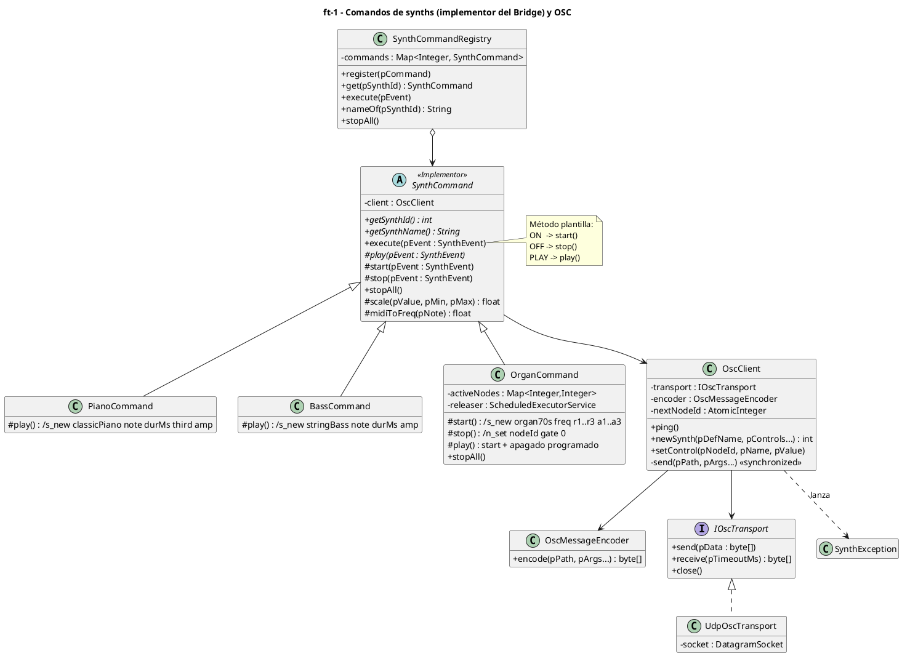
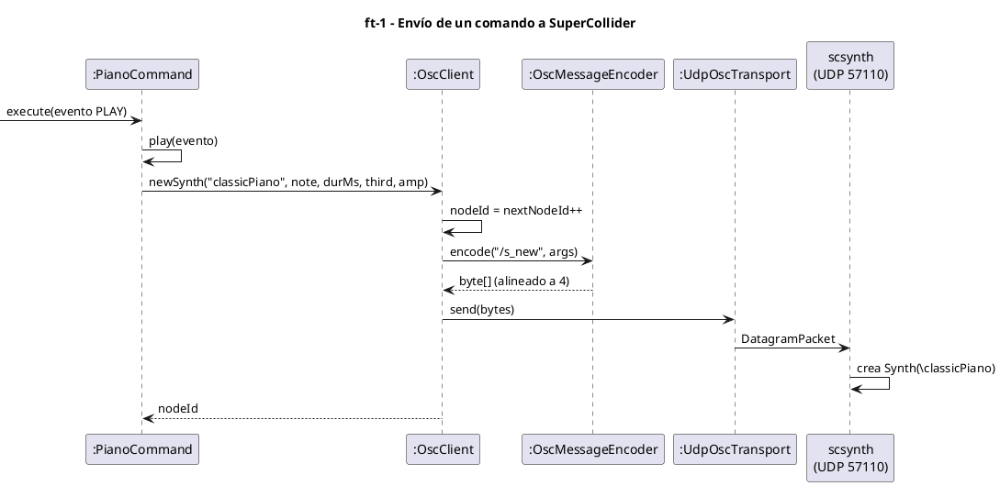

# Conexión con SuperCollider y comandos de los synths (Bridge - implementación)

## General description

- Cliente OSC sobre UDP hacia scsynth (puerto 57110), basado en `BandClient.java` del profesor.
- Jerarquía `SynthCommand` = implementor del Bridge: un comando por synth de `myband.sc` (`classicPiano`, `stringBass`, `organ70s`).
- Cada comando traduce un `SynthEvent` genérico (nota, duración, velocidad, 3 timbres 0..1) a los parámetros de su synth.

## Inputs

- `SynthEvent` (dto): offsetMs, synthId, action (PLAY/ON/OFF), note, durMs, velocity, timbre1..3.
- Host y puerto de scsynth (argumentos de `main` o constantes).

## Outputs

- Paquetes OSC `/s_new defName nodeId 0 1 [param valor...]` y `/n_set nodeId gate 0`.
- `/status` para verificar que el servidor responde (`/status.reply`).

## Test criteria

- Todo mensaje OSC mide un múltiplo de 4 bytes; enteros y floats big-endian.
- Piano manda `/s_new` con `classicPiano` y `third` (4 mayor si timbre1 >= 0.5, si no 3).
- Bajo manda `/s_new` con `stringBass`.
- Órgano: ON manda `/s_new organ70s`; OFF manda `/n_set ... gate 0`; OFF sin ON no manda nada.
- Piano y bajo ignoran OFF (se apagan solos).
- `SynthCommandRegistry` envía cada evento al comando de su synthId; id desconocido lanza `SynthException`.
- `ping()` lanza `SynthException` si no hay respuesta.

## Assets

- `supercollider/myband.sc` (synths del profesor, sin cambios).
- Constantes OSC_*, SYNTH_*, PARAM_*, PIANO_*, BASS_*, ORGAN_* en `IConstants`.
- Diagrama PlantUML `specs/diagrams/ft-1-bridge-synths.puml` (imagen en `specs/diagrams/png/ft-1-bridge-synths.png`):

- Diagrama PlantUML `specs/diagrams/ft-1-envio-comando.puml` (imagen en `specs/diagrams/png/ft-1-envio-comando.png`):

## Implementation guidelines

- Paquetes: `src/main/java/powerband/osc/` (`IOscTransport`, `UdpOscTransport`, `OscMessageEncoder`, `OscClient`) y `src/main/java/powerband/synth/` (`SynthCommand`, `PianoCommand`, `BassCommand`, `OrganCommand`, `SynthCommandRegistry`).
- `SynthCommand.execute` es método plantilla: ON → start, OFF → stop, PLAY → play. Defaults: start = play, stop = nada.
- `OscClient.send` es synchronized (3 hilos de instrumentos comparten el socket).
- `OrganCommand` guarda nota → nodeId y programa el apagado cuando recibe PLAY (otro instrumento conectado por Bridge).
- Errores de `IOException` se envuelven en `SynthException`.

## Business workflow

- Main crea `OscClient(new UdpOscTransport(host, port))` y llama `ping()`; si falla avisa y sigue.
- Main registra los tres comandos en `SynthCommandRegistry`.
- Al recibir un evento, el comando lo convierte a OSC y lo envía.
