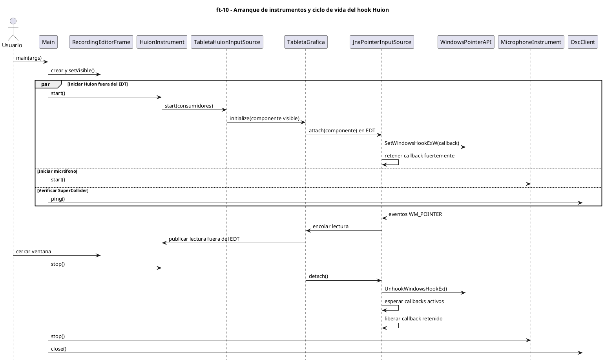

# Arranque de instrumentos y hook Huion

## General description

- Componer el editor, la grabación, OSC, Huion/saxofón y micrófono/violín desde el punto de entrada.
- Retener la callback JNA mientras el hook esté instalado y liberarla solo después de desregistrarlo y completar los callbacks activos.

## Inputs

- `main(String[] pArguments)` en `powerband.Main`.
- `RecordingService`, `BinaryRecordingRepository`, `RecordingEditorFrame` y endpoint OSC configurado.
- Lecturas y fallos asíncronos de Huion; muestras y fallos del micrófono.

## Outputs

- Eventos Huion al `SaxophoneCommand` y eventos del micrófono al `ViolinCommand`, compartidos con `RecordingService`.
- Inicio no bloqueante de instrumentos; errores aislados por dispositivo.
- Hook JNA removido y callback liberada al cerrar la aplicación.

## Test criteria

- `Main` muestra el frame antes de pedir la inicialización de la fuente Huion.
- La falta de Huion, micrófono o SuperCollider se reporta explícitamente y no cancela el inicio de los otros componentes.
- La callback que se pasa a `SetWindowsHookExW` permanece fuertemente referenciada hasta que `UnhookWindowsHookEx` termina y los callbacks activos finalizan.
- Si falla el unhook o se interrumpe la espera por callbacks, no se libera prematuramente la referencia a la callback.
- El cierre libera los instrumentos antes de cerrar `OscClient`.

## Assets

- Secuencia de composición y ciclo de vida JNA, compartida con `../frontend/ft-10-arranque-instrumentos-huion.md`:

## Implementation guidelines

- Usar Java 25+, Maven y las dependencias ya declaradas; no agregar una DLL propia.
- Mantener el punto de entrada en `src/main/java/powerband/Main.java`.
- Mantener instrumentos en `src/main/java/powerband/instrument/`, comandos Bridge en `src/main/java/powerband/synth/`, servicio en `src/main/java/powerband/service/`, OSC en `src/main/java/powerband/osc/` y constantes en `src/main/java/powerband/util/IConstants.java`.
- La inicialización que requiere un componente visible debe ejecutarse después de mostrar `RecordingEditorFrame`; las llamadas potencialmente bloqueantes no deben ejecutarse en el EDT.
- En `src/main/java/powerband/instrument/JnaPointerInputSource.java`, mantener una referencia fuerte a `PointerHook` desde la instalación exitosa hasta completar el desregistro y las callbacks activas.
- Preservar la abstracción Bridge y propagar fallos de dispositivo o E/S mediante excepciones y notificaciones explícitas.

## Business workflow

1. Crear el servicio de grabación, el transporte OSC y los comandos de saxofón y violín.
2. Asociar la fuente Huion al componente del editor y mostrar la ventana.
3. Iniciar instrumentos y consultar SuperCollider en tareas separadas.
4. Enviar lecturas y fallos asíncronos al instrumento correspondiente y publicar eventos al servicio de grabación.
5. Al cerrar, detener ambos instrumentos, retirar el hook y cerrar el transporte OSC.
