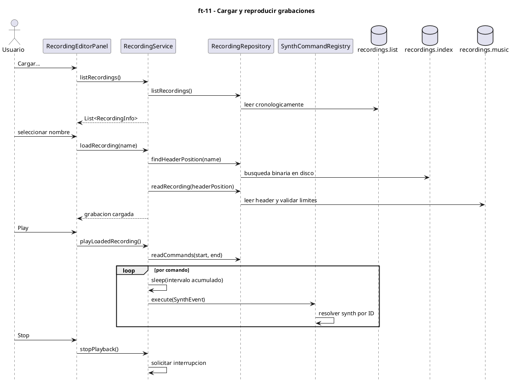

# Cargar y reproducir grabaciones

## General description

- Extender `RecordingService` con listado, carga, reproducción y detención de grabaciones existentes.
- Usar el índice binario por nombre y leer comandos desde `recordings.music` sin alterar offsets ni parámetros.
- Ejecutar los `SynthEvent` en intervalos reales derivados de `offsetMs`, conservando la fidelidad temporal.

## Inputs

- Nombre seleccionado desde la lista cronológica.
- Posición del encabezado obtenida mediante búsqueda binaria.
- Header y comandos almacenados en `recordings.music`.
- Comandos actuales de los synths y su `SynthCommandRegistry`.

## Outputs

- `List<RecordingInfo>` en orden cronológico.
- Una grabación cargada con nombre, posición inicial/final y comandos disponibles.
- Ejecución en secuencia de `SynthEvent` preservando intervalos relativos.
- Eventos, errores y estado de reproducción al editor.

## Test criteria

- `listRecordings()` entrega exactamente las líneas de `recordings.list` en su orden físico.
- `loadRecording(name)` rechaza nombres ausentes con `RecordingNotFoundException`.
- La carga valida el encabezado, su nombre fijo y que los límites estén dentro de `recordings.music`.
- `playLoadedRecording()` reproduce solo los comandos comprendidos entre el inicio y el fin exclusivos del encabezado.
- Los comandos se ejecutan en los intervalos acumulados definidos por `offsetMs`, independientemente de la hora de carga.
- `stopPlayback()` cancela el hilo o tarea activa y libera la nota/pista sin iniciar una nueva grabación.
- No se permite cargar o reproducir mientras existe una grabación activa o pendiente de nombre.
- Los IDs legacy 1 y 2 conservan su resolución a piano y bajo; los demás IDs usan el registro actual.

## Assets

## Implementation guidelines

- Java 25+, Maven, JUnit 5 y el patrón Bridge existente.
- Mantener la lógica de reproducción en `src/main/java/powerband/service/`.
- Extender `src/main/java/powerband/repository/RecordingRepository.java` y `BinaryRecordingRepository` sin modificar los registros existentes.
- Usar `SynthEvent`, `SynthCommandRegistry`, `RecordingInfo` y excepciones propias existentes.
- Bufferizar como máximo `PLAYBACK_BUFFER_SIZE` comandos por ciclo de reproducción; no cargar ni recorrer el índice completo en memoria.
- Respetar `MUSIC_RECORD_SIZE`, el encabezado fijo y offsets relativos con `NANOS_PER_MILLI`.
- Los tiempos deben esperar intervalos acumulados entre offsets y no depender de cuándo se cargó el archivo.

## Business workflow

1. Leer `recordings.list` en orden cronológico y devolver `RecordingInfo`.
2. Buscar por nombre en `recordings.index` mediante búsqueda binaria en disco.
3. Leer el encabezado de `recordings.music` y guardar sus límites inicial y final exclusivo.
4. Leer comandos desde el límite inicial hasta el final con buffering limitado.
5. Ejecutar cada comando con el intervalo acumulado correspondiente y reportar estado al editor.
6. Interrumpir cualquier reproducción activa sin afectar grabaciones guardadas.
