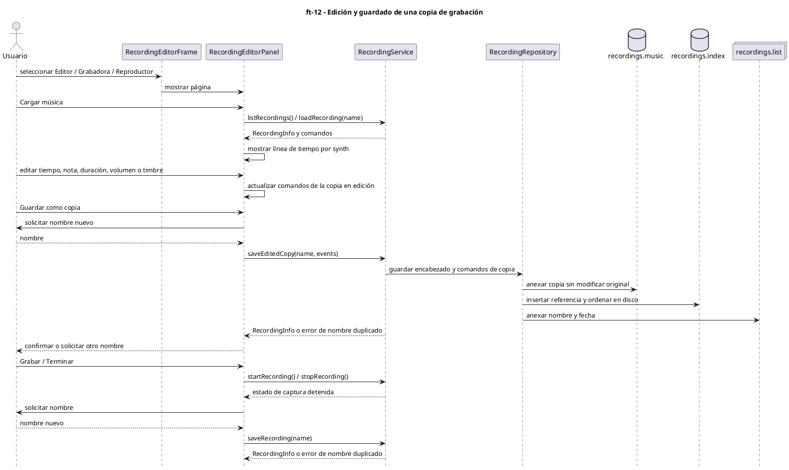

# Servicio para editar copias de grabaciones

## General description

- Extender `RecordingService` para entregar los comandos de una grabación cargada y guardar sus cambios como una grabación nueva.
- Preservar todos los campos originales no editados y mantener intacta la grabación fuente.
- Validar el nombre de la copia con las reglas existentes y conservar la captura o edición pendiente cuando el nombre esté duplicado o sea inválido.

## Inputs

- Nombre de una grabación existente.
- Lista editada `List<SynthEvent>` con offset, nota, duración, velocidad/volumen y tres valores de timbre.
- Nombre para la nueva grabación.
- Eventos recibidos durante la grabación en vivo.

## Outputs

- `RecordingInfo` y comandos de la grabación cargada para la interfaz.
- `RecordingInfo` de la copia guardada.
- `DuplicateNameException`, `InvalidNameException`, `RecordingNotFoundException` o `RecordingException`.
- Eventos registrados con offsets relativos al inicio y en su orden temporal.

## Test criteria

- Cargar una grabación devuelve sus comandos y metadatos sin mutar el repositorio ni los eventos originales.
- Guardar una copia con nombre único crea una grabación independiente cuyos comandos contienen las ediciones solicitadas y conservan los demás campos.
- Guardar una copia con nombre duplicado lanza `DuplicateNameException`; el siguiente intento con nombre disponible puede guardar la misma edición.
- Nombres inválidos producen `InvalidNameException` y no alteran la grabación fuente ni crean una copia parcial.
- La copia conserva la fecha/hora de creación nueva y se agrega al final del listado cronológico.
- La grabación en vivo acepta solo una captura a la vez; al detenerla queda pendiente para nombre y se pueden reintentar nombres rechazados.

## Assets

## Implementation guidelines

- Usar Java 25+, Maven y JUnit 5.
- Mantener la lógica en `src/main/java/powerband/service/RecordingService.java` y los contratos de persistencia en `src/main/java/powerband/repository/RecordingRepository.java`.
- Reutilizar `SynthEvent`, `RecordingInfo` y las excepciones propias existentes.
- Validar nombres con `NAME_LENGTH`, `NAME_PATTERN` y las constantes de error de `IConstants`; no duplicar reglas.
- No sustituir ni modificar la grabación de origen; las ediciones se guardan bajo un nuevo nombre.
- No ordenar ni recorrer arreglos en memoria para el índice; conservar la búsqueda binaria y el Balanced Merge Sort en disco.

## Business workflow

1. Resolver el nombre de origen mediante el repositorio y leer sus comandos.
2. Devolver una vista de comandos a la UI para su edición, manteniendo intacta la grabación persistida.
3. Validar el nombre nuevo y comprobar duplicados mediante el índice.
4. Enviar el encabezado y comandos editados al repositorio para anexar una grabación independiente.
5. Actualizar el índice en disco y agregar la copia al listado cronológico.
6. Devolver `RecordingInfo`; ante errores de nombre mantener disponible la edición pendiente para reintentar.
