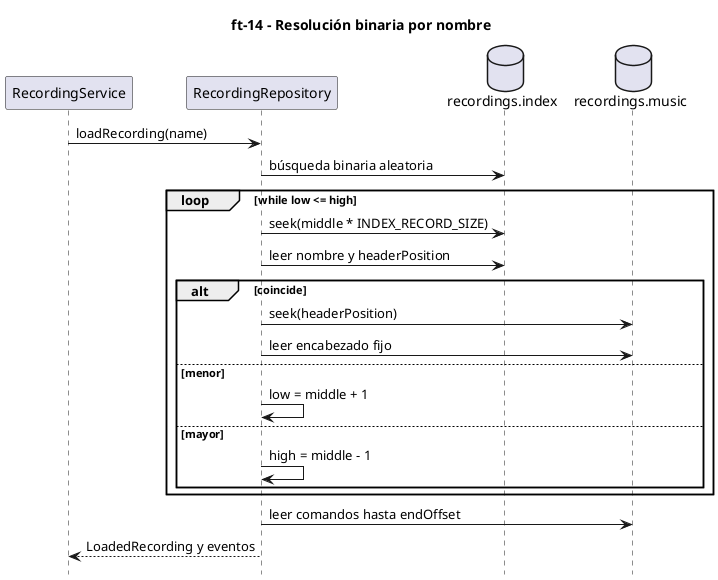

# Resolución binaria de grabaciones

## General description

- Añadir al servicio una carga por nombre exacto basada en la posición del índice.
- Resolver la posición con búsqueda binaria en disco y validar el encabezado de `recordings.music`.
- Devolver metadatos y comandos sin modificar ni recorrer el índice en memoria.

## Inputs

- Nombre exacto validado por el usuario.
- `recordings.index` ordenado por nombre.
- `recordings.music` con encabezados y comandos de tamaño fijo.

## Outputs

- `LoadedRecording` con nombre, posición inicial, fin exclusivo y fecha.
- Lista de `SynthEvent` comprendidos dentro de los límites del encabezado.
- `RecordingNotFoundException` o `RecordingException`.

## Test criteria

- `loadRecording(name)` busca primero el encabezado por nombre exacto.
- El índice se lee por posiciones calculadas con `INDEX_RECORD_SIZE`.
- El encabezado debe coincidir con el nombre solicitado y tener límites alineados.
- Los comandos se leen solo desde el registro siguiente al encabezado hasta `endOffset`.
- Un índice truncado o música inconsistente falla con excepción propia.
- No se carga el índice completo ni se usa un arreglo/colección para ordenar nombres.

## Assets

## Implementation guidelines

- Java 25+, Maven y `RandomAccessFile`.
- Mantener lógica de composición en `src/main/java/powerband/service/`.
- Mantener acceso binario en `src/main/java/powerband/repository/`.
- Reutilizar `RecordingFileFormat`, `LoadedRecording`, `SynthEvent` e `IConstants`.
- No modificar registros de origen ni crear arreglos con el índice completo.
- Envolver I/O corrupta o truncada en `RecordingException`.

## Business workflow

1. Validar el nombre solicitado.
2. Resolver posición mediante búsqueda binaria en `recordings.index`.
3. Leer y validar el encabezado en `recordings.music`.
4. Leer comandos desde `headerPosition + MUSIC_RECORD_SIZE` hasta `endOffset`.
5. Devolver metadatos/eventos o excepción propia.
