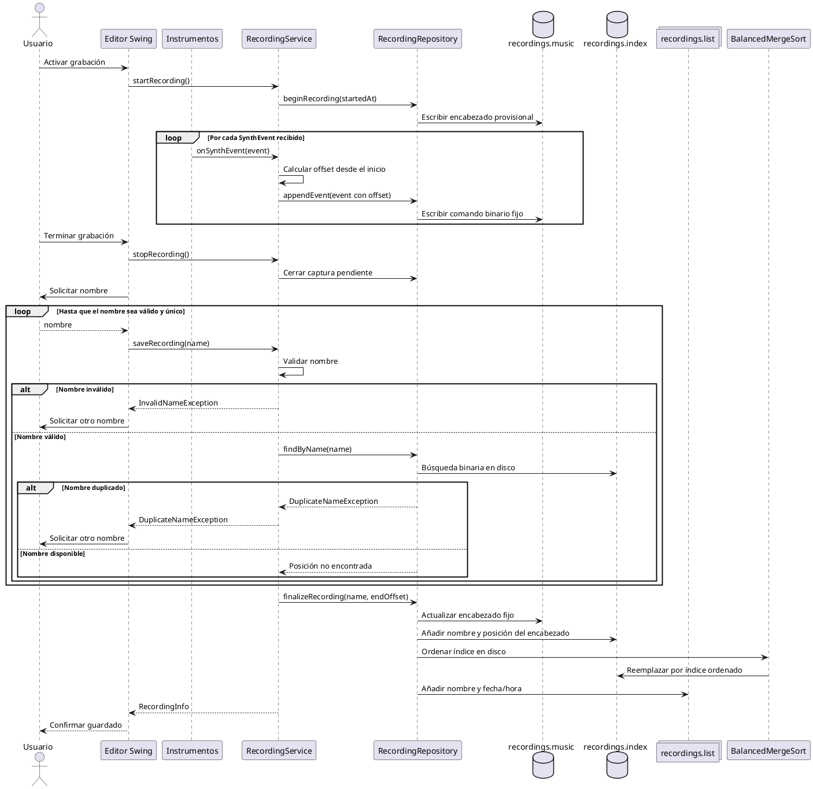

# Guardado de grabaciones del editor musical

## General description

- El servicio coordina el inicio, la captura en tiempo real y el cierre de una grabación.
- Calcula el tiempo relativo de cada `SynthEvent`, valida el nombre final y delega el almacenamiento al repositorio.
- Mantiene en espera la grabación detenida mientras se resuelve un nombre inválido o duplicado.

## Inputs

- `startRecording()`, `onSynthEvent(SynthEvent)` y `stopRecording()` desde el editor/instrumentos.
- `saveRecording(String name)` después de detener la captura.

## Outputs

- `RecordingInfo` para una grabación guardada.
- Errores `InvalidNameException`, `DuplicateNameException` y `RecordingException` para rechazos o fallas.
- Eventos de comando con `offsetMs` relativo al inicio, enviados al repositorio durante la captura.

## Test criteria

- El servicio rechaza iniciar una segunda captura simultánea.
- Cada evento aceptado se entrega al repositorio con tiempo relativo no negativo y conserva el orden de recepción.
- Detener impide aceptar eventos nuevos para esa captura y conserva los eventos ya escritos mientras se solicita el nombre.
- Nombres vacíos, demasiado largos o fuera de `NAME_PATTERN` producen `InvalidNameException`.
- Un nombre ya indexado produce `DuplicateNameException`; el siguiente intento puede finalizar la misma captura.
- Un nombre disponible finaliza la grabación y devuelve `RecordingInfo`.

## Assets

## Implementation guidelines

- Java 22+, Maven; lógica en `src/main/java/powerband/service/` y datos de entrada/salida en `src/main/java/powerband/dto/`.
- Reutilizar `SynthEvent`, `RecordingInfo` y las excepciones existentes en `src/main/java/powerband/exception/`.
- Validar nombres con `NAME_LENGTH`, `NAME_PATTERN` y los mensajes de `src/main/java/powerband/util/IConstants.java`; no duplicar constantes.
- Medir intervalos con reloj monotónico y `NANOS_PER_MILLI`; no calcular el tiempo relativo con la fecha/hora del sistema.
- Coordinar eventos concurrentes de instrumentos para serializarlos en el orden de recepción, sin perder eventos durante la captura.
- Envolver errores de persistencia en excepciones propias; no ignorar fallos ni reportar éxito parcial como guardado exitoso.

## Business workflow

1. Al iniciar, el servicio registra el instante monotónico de inicio y pide al repositorio abrir el registro pendiente.
2. Por cada evento de instrumento, calcula el offset relativo y lo envía inmediatamente al repositorio.
3. Al detener, cierra la entrada de eventos y conserva pendiente la grabación aún sin nombre.
4. Valida el nombre final; ante nombre inválido o duplicado, conserva la captura detenida para otro intento.
5. Con un nombre único, pide al repositorio finalizar y catalogar la grabación, y devuelve `RecordingInfo`.
