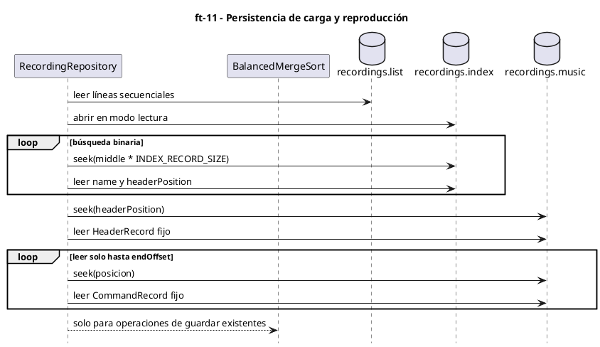

# Lectura y reproducción binaria de grabaciones

## General description

- Extender el repositorio para leer `recordings.list`, localizar encabezados por nombre y obtener comandos de `recordings.music`.
- Mantener registros binarios de tamaño fijo y búsqueda aleatoria en disco.
- No ordenar ni recorrer el índice completo en memoria.

## Inputs

- Nombre de una grabación seleccionada.
- Posición del encabezado y límites inicial/final del encabezado.
- Directorio `data/` que contiene los tres archivos.

## Outputs

- Lista cronológica de `RecordingInfo`.
- Encabezado validado y posición inicial/final.
- Comandos `SynthEvent` consecutivos desde `recordings.music`.

## Test criteria

- `recordings.list` se lee línea por línea y cada línea válida devuelve `nombre|fecha` como `RecordingInfo`.
- Una lista faltante o vacía devuelve una lista vacía o una excepción configurada; no se fabrica una grabación.
- La búsqueda de nombre usa registros de `INDEX_RECORD_SIZE` y busca desde disco sin cargar todos los registros en una colección.
- El encabezado leído desde `MUSIC_RECORD_SIZE` coincide con el nombre, contiene límites válidos y tiene tipo `H`.
- Los comandos posteriores se leen como registros de `MUSIC_RECORD_SIZE` con tipo `C`, offsets y parámetros válidos.
- No se leen registros fuera del límite final exclusivo del encabezado.
- Archivos truncados, índices corruptos y tamaños no múltiplos producen `RecordingException` con causa de E/S.
- Los streams se cierran con try-with-resources y las posiciones aleatorias no dejan errores de concurrencia.

## Assets

## Implementation guidelines

- Java 25+, Maven y `RandomAccessFile`.
- Implementar únicamente en `src/main/java/powerband/repository/`.
- Reutilizar `RecordingFileFormat`, `IConstants`, `SynthEvent` y `RecordingInfo`.
- Añadir métodos de lectura sin sustituir ni reordenar el índice; mantener la búsqueda binaria existente.
- Leer encabezado y comandos con tamaño fijo y validar tipos, límites y offsets antes de devolver datos.
- Conservar try-with-resources y envolver todas las fallas de E/S en excepciones propias.

## Business workflow

1. Leer `recordings.list` secuencialmente y convertir líneas válidas en `RecordingInfo`.
2. Resolver el nombre con búsqueda binaria sobre `recordings.index`.
3. Leer el encabezado fijo ubicado por el índice y validar sus límites.
4. Leer registros de comando hasta el fin exclusivo, sin pasar al siguiente encabezado.
5. Devolver los datos al servicio en lotes limitados o mediante iteración controlada.
