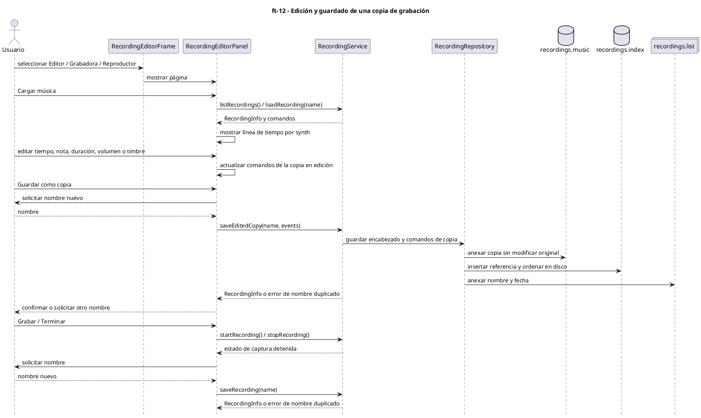

# Persistencia de copias editadas

## General description

- Extender el repositorio binario para leer los comandos de una grabación y anexar una copia editada bajo un nombre nuevo.
- Mantener el formato binario fijo existente, los registros originales y sus posiciones intactos.
- Actualizar `recordings.index` mediante Balanced Merge Sort en disco y agregar una entrada cronológica a `recordings.list`.

## Inputs

- Nombre y posición inicial/final de la grabación origen.
- Nombre único, fecha de creación y comandos editados (`List<SynthEvent>`) para la copia.
- Formatos existentes `MUSIC_RECORD_SIZE`, `INDEX_RECORD_SIZE` y tipos de registro.

## Outputs

- Metadatos y comandos leídos dentro de los límites del encabezado solicitado.
- `RecordingInfo` de la copia anexada.
- Error de persistencia si la grabación no existe, el nombre ya está ocupado o ocurre una falla de E/S.

## Test criteria

- La lectura por nombre usa búsqueda binaria en `recordings.index` y lee únicamente los registros entre los límites del encabezado en `recordings.music`.
- Cada registro de la copia mantiene exactamente `MUSIC_RECORD_SIZE`; la nueva entrada del índice mantiene `INDEX_RECORD_SIZE`.
- Anexar una copia no altera bytes ni encabezado de la grabación origen.
- Una copia exitosa incluye el nombre, fecha nueva, límites correctos y comandos editados; el índice queda ordenado con Balanced Merge Sort y el listado conserva orden cronológico.
- Un nombre duplicado o una falla durante la escritura no produce una entrada de índice/lista ni una copia parcial que se reporte como guardada.
- La búsqueda y el ordenamiento del índice ocurren en archivos; no se carga, ordena ni recorre el índice en arreglos en memoria.

## Assets

## Implementation guidelines

- Usar Java 25+, Maven y archivos de datos existentes en `data/`.
- Extender `src/main/java/powerband/repository/RecordingRepository.java` y `BinaryRecordingRepository.java`; reutilizar `RecordingFileFormat` y `BalancedMergeSort`.
- Serializar encabezados y comandos con `MUSIC_RECORD_SIZE` y entradas de índice con `INDEX_RECORD_SIZE`.
- Leer por búsqueda binaria en disco y ordenar el índice con Balanced Merge Sort en disco; no usar arreglos en memoria para indexación.
- Usar `RandomAccessFile` y streams con try-with-resources. Envolver errores de E/S en `RecordingException` o sus descendientes.
- Validar límites y duplicados antes de publicar la copia; usar los mecanismos de rollback existentes para impedir resultados parciales.

## Business workflow

1. Buscar en el índice el encabezado de la grabación origen.
2. Validar que sus límites estén alineados con registros válidos y leer los comandos comprendidos en ellos.
3. Comprobar que el nombre de la copia no exista.
4. Anexar al archivo de música el encabezado nuevo y los comandos editados, conservando el registro de origen.
5. Añadir la referencia al índice de trabajo, ordenar en disco y sustituir el índice vigente.
6. Agregar el nombre y la fecha al final de `recordings.list`.
7. Ante cualquier fallo, revertir las actualizaciones publicadas y reportar la excepción.
