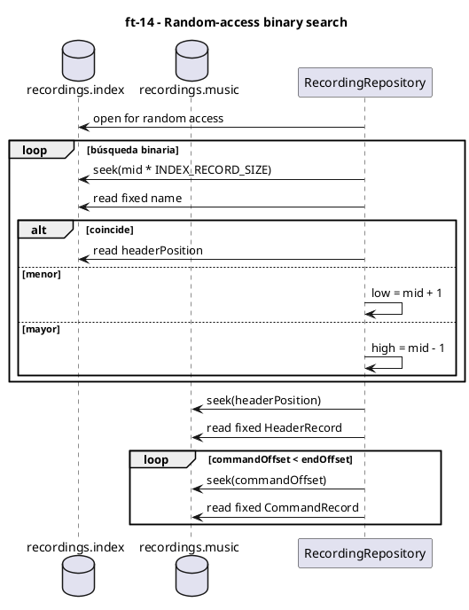

# Archivos binarios de búsqueda

## General description

- Implementar búsquedas físicas sobre `recordings.index` con registros de `INDEX_RECORD_SIZE`.
- Localizar el encabezado y leer registros de `recordings.music` dentro de límites exactos.
- Conservar formato fijo, offsets y Balanced Merge Sort existentes.

## Inputs

- Nombre exacto.
- Archivo binario `recordings.index` ordenado por nombre.
- Archivo binario `recordings.music`.

## Outputs

- Posición del encabezado.
- Encabezado validado.
- Comandos `SynthEvent` serializados dentro de la grabación.

## Test criteria

- El tamaño de `recordings.index` debe ser múltiplo de `INDEX_RECORD_SIZE`.
- `findHeaderPosition(name)` calcula bajo/alto por cantidad de registros y usa `seek`.
- La comparación usa el nombre fijo leído desde disco.
- El encabezado coincide exactamente con el nombre y sus offsets están alineados.
- `readEvents(name)` devuelve solo registros `C` dentro del límite exclusivo.
- Archivos truncados, offsets fuera de rango y tipos incorrectos producen excepciones propias.
- No se ordenan ni recorren índices completos en memoria.

## Assets

## Implementation guidelines

- Java 25+, `RandomAccessFile` y try-with-resources.
- Implementar en `src/main/java/powerband/repository/`.
- Reutilizar `RecordingFileFormat.readIndexEntry`, `readHeader`, `readCommand` y constantes.
- Mantener registros de `MUSIC_RECORD_SIZE` e índices de `INDEX_RECORD_SIZE`.
- No cargar `recordings.index` completo ni reemplazarlo durante la búsqueda.

## Business workflow

1. Abrir el índice y validar su longitud.
2. Calcular la cantidad de registros y aplicar búsqueda binaria con `seek`.
3. Encontrar la posición del encabezado exacto.
4. Abrir música y validar el encabezado fijo.
5. Leer comandos secuencialmente hasta `endOffset`.
6. Reportar excepciones personalizadas ante cualquier condición inválida.
