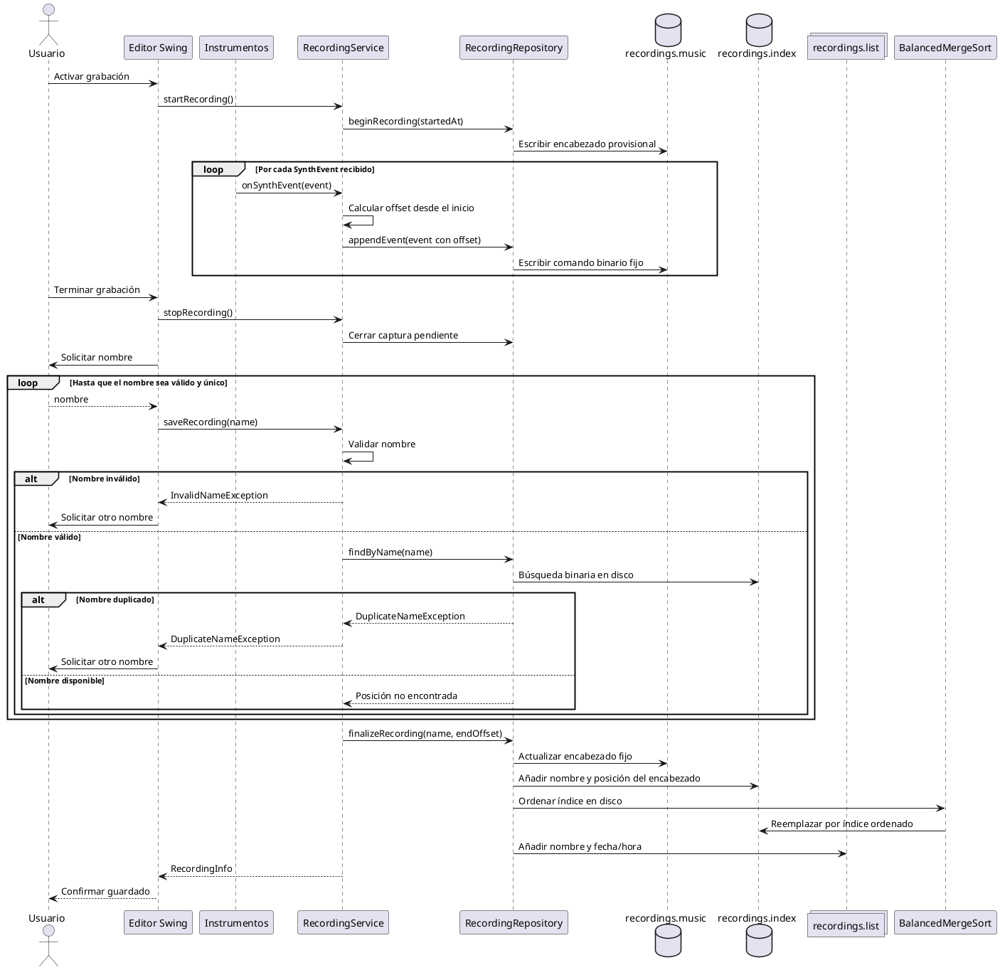

# Persistencia de grabaciones del editor musical

## General description

- El repositorio persiste las grabaciones en `data/recordings.music`, `data/recordings.index` y `data/recordings.list`.
- Escribe comandos mientras ocurre la captura; al finalizar fija el nombre y los límites del encabezado.
- El índice usa registros binarios de tamaño fijo, búsqueda binaria en disco y Balanced Merge Sort en archivos.

## Inputs

- Inicio de captura y fecha/hora de grabación.
- `SynthEvent` con offset relativo.
- Nombre validado de la grabación.

## Outputs

- Posición del encabezado y límites de bytes de la grabación.
- Resultado de búsqueda por nombre o `RecordingNotFoundException`.
- `RecordingInfo` y estado de guardado para el servicio.

## Test criteria

- Cada registro de `recordings.music` mide exactamente `MUSIC_RECORD_SIZE`; encabezado y comandos se serializan con el tipo correcto.
- Cada registro de `recordings.index` mide exactamente `INDEX_RECORD_SIZE` y contiene el nombre fijo y la posición del encabezado en `recordings.music`.
- Los comandos se anexan en tiempo real, conservan offset, synth, acción y parámetros, y quedan después del encabezado provisional.
- Al finalizar, el encabezado guarda nombre, offset inicial, offset final exclusivo y fecha/hora; sus offsets permiten leer solo esa grabación.
- La búsqueda binaria lee registros por posición desde el archivo, encuentra nombres existentes y lanza `RecordingNotFoundException` cuando no existen.
- Después de cada grabación guardada, Balanced Merge Sort deja `recordings.index` ordenado por nombre sin ordenar ni recorrer arreglos en memoria.
- `recordings.list` agrega exactamente una línea `nombre|fecha` por grabación y conserva orden cronológico.
- Fallas de E/S se propagan como excepciones personalizadas; todos los streams y archivos se cierran correctamente.

## Assets

## Implementation guidelines

- Java 25+, Maven; persistencia, búsqueda y ordenamiento en `src/main/java/powerband/repository/`.
- Usar `src/main/java/powerband/util/IConstants.java` para tamaños, nombres de archivo, relleno, tipos de registro y parámetros de ordenamiento.
- Serializar encabezados y comandos como registros de `MUSIC_RECORD_SIZE` bytes; serializar el índice como `INDEX_RECORD_SIZE` bytes. Mantener el orden de bytes fijo y compatible entre lectura y escritura.
- Conservar `recordings.music` como encabezado seguido por comandos; el offset final del encabezado es exclusivo.
- Usar streams binarios y `RandomAccessFile` cuando se requiera actualizar o buscar por posición; cerrar todo con try-with-resources.
- Ejecutar la búsqueda binaria y Balanced Merge Sort únicamente sobre archivos; las cintas temporales usan las constantes existentes.
- Envolver errores de E/S en `RecordingException` o descendientes; reutilizar `DuplicateNameException` y `RecordingNotFoundException`.

## Business workflow

1. Abrir `recordings.music` en append y escribir un encabezado provisional de tamaño fijo.
2. Por cada evento recibido, escribir un registro de comando fijo inmediatamente.
3. Al recibir un nombre único, actualizar el encabezado con nombre, inicio, fin y fecha/hora.
4. Añadir nombre y posición del encabezado al índice, ordenar el índice con Balanced Merge Sort en disco y reemplazarlo.
5. Anexar nombre y fecha a `recordings.list` para conservar el orden cronológico.
6. Para comprobar un nombre, buscar en el índice mediante lecturas aleatorias; si no está, informar que no se encontró.
