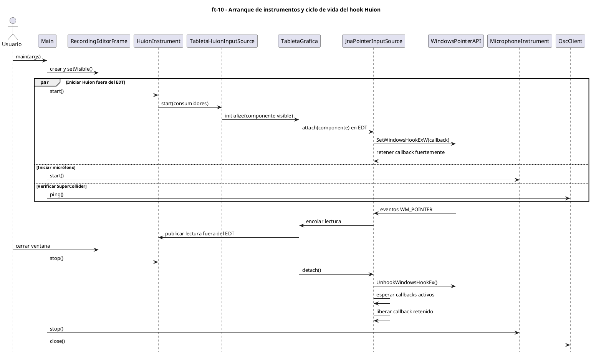

# Arranque de instrumentos y hook Huion

## General description

- Mostrar el editor Swing y enlazar su componente visible con la captura Huion.
- Mantener la ventana operativa cuando SuperCollider o un instrumento no esté disponible; informar el fallo sin impedir iniciar los demás instrumentos.

## Inputs

- Inicio de `powerband.Main`.
- Ventana `RecordingEditorFrame` y su componente de contenido.
- Errores de inicialización de Huion, micrófono y SuperCollider.

## Outputs

- Editor visible antes de inicializar la tableta.
- Avisos de disponibilidad de SuperCollider y errores de instrumento mostrados al usuario.

## Test criteria

- El componente de captura es displayable antes de inicializar `TabletaHuionInputSource`.
- La falta de respuesta de SuperCollider muestra un aviso y no cierra el editor.
- Un fallo de Huion no impide intentar iniciar el micrófono; un fallo del micrófono no impide intentar iniciar Huion.
- Al cerrar la ventana se solicita detener los instrumentos y liberar el cliente OSC.

## Assets

- Secuencia de arranque y cierre, compartida con `../backend/ft-10-arranque-instrumentos-huion.md`:

## Implementation guidelines

- Usar Java 25+, Maven y Swing.
- Mantener la composición de arranque en `src/main/java/powerband/Main.java` y la ventana en `src/main/java/powerband/ui/`.
- Mostrar el frame antes de iniciar la captura Huion; no bloquear el EDT con inicialización de dispositivos o ping OSC.
- Mantener los mensajes y valores configurables en `src/main/java/powerband/util/IConstants.java`.

## Business workflow

1. Construir el servicio de grabación, el cliente OSC y los instrumentos disponibles.
2. Mostrar el editor para que la superficie asociada a Huion tenga peer nativo.
3. Iniciar Huion, micrófono y verificación de SuperCollider sin que un fallo individual cancele los demás.
4. Reportar errores en la interfaz y mantener el editor abierto.
5. Al cerrar, detener instrumentos y cerrar el cliente OSC.
