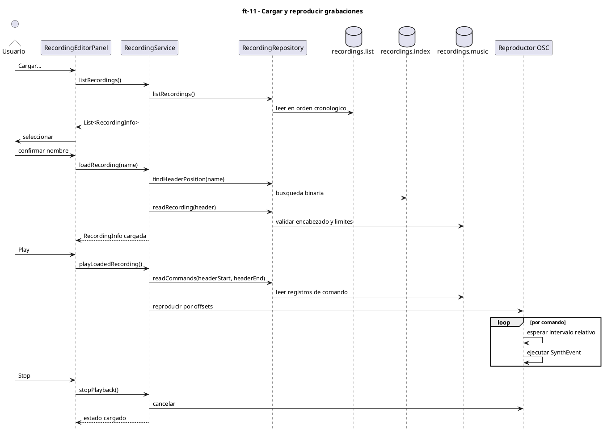

# Cargar y reproducir grabaciones

## General description

- Ampliar el editor Swing con acciones para cargar una grabación y reproducirla o detenerla.
- Mostrar las grabaciones desde `recordings.list` en orden cronológico y permitir seleccionar una por nombre.
- Actualizar el estado, el nombre cargado y los errores sin confundir una reproducción con una grabación nueva.

## Inputs

- Botón `Cargar...`, selección de una grabación y acciones `Play`/`Stop`.
- `RecordingInfo`, posición del encabezado y errores entregados por `RecordingService`.
- Eventos de reproducción enviados al monitor y al reproductor de synths.

## Outputs

- Solicitud al servicio para listar, cargar, iniciar, detener o informar reproducción.
- Estado visual cargado, reproduciendo o detenido.
- Mensajes de selección vacía, grabación no encontrada y fallas de E/S.

## Test criteria

- `Cargar...` ofrece nombres en el orden exacto de `recordings.list`; una lista vacía muestra el mensaje correspondiente.
- Seleccionar una grabación carga su nombre y límites de bytes antes de habilitar `Play`.
- `Play` no inicia mientras hay una captura activa o una reproducción ya iniciada.
- `Stop` detiene la reproducción y vuelve al estado cargado sin borrar la grabación.
- Cerrar la ventana o abandonar el modo cargado detiene una reproducción activa antes de liberar recursos.
- Las excepciones se muestran como errores y nunca como confirmación de carga o reproducción.

## Assets

## Implementation guidelines

- Usar Java 25+, Maven y Swing.
- Mantener controles y estado en `src/main/java/powerband/ui/RecordingEditorPanel.java` y `src/main/java/powerband/ui/RecordingEditorFrame.java`.
- Delegar archivos y reproducción a `src/main/java/powerband/service/` y `src/main/java/powerband/repository/`; no leer archivos binarios desde la UI.
- Agregar botones y textos usando constantes existentes o nuevas constantes publicadas en `src/main/java/powerband/util/IConstants.java`.
- Mantener los parámetros de métodos con prefijo `p` y presentar todos los fallos mediante excepciones propias.

## Business workflow

1. El usuario pulsa `Cargar...`; la UI solicita la lista cronológica al servicio.
2. Presenta las grabaciones sin modificar su orden y permite seleccionar una.
3. El servicio carga el encabezado y limita la reproducción a los registros de esa grabación.
4. El usuario inicia `Play`; la UI muestra estado de reproducción y puede detenerlo.
5. Al detener o cerrar, cancela el hilo de reproducción y conserva la grabación cargada hasta reemplazarla.
