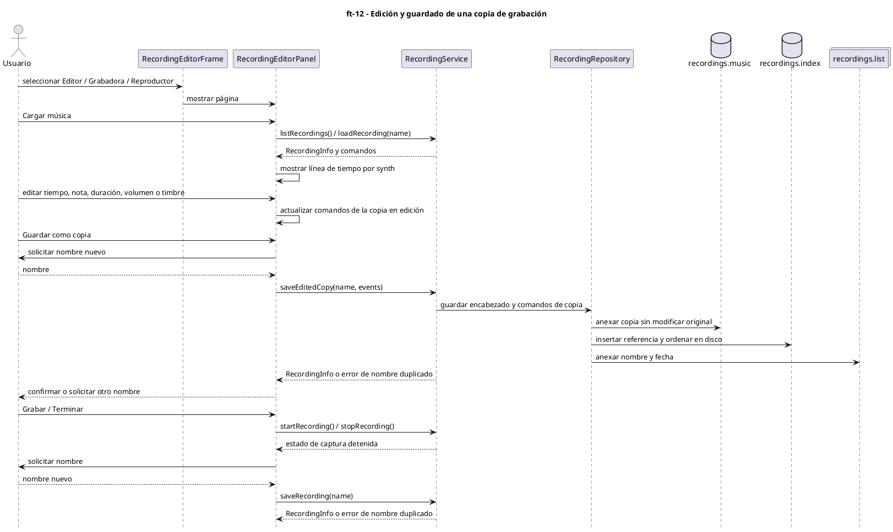

# Interfaz del editor musical

## General description

- Ampliar la aplicación Swing con una ventana Power Band de tres páginas navegables: Editor, Grabadora y Reproductor.
- Usar fondo gris, acentos azules, tipografía blanca y un encabezado centrado con el nombre Power Band en rojo.
- Mostrar en Editor la grabación cargada como una línea de tiempo por sintetizador; permitir editar tiempo, nota, duración, volumen y timbres de cada comando.
- Guardar las ediciones como una grabación nueva, sin sobrescribir la original.
- Ofrecer acciones para grabar, reproducir y cargar música. Al detener la grabación, solicitar un nombre y permitir corregir errores de nombre duplicado sin perder la grabación pendiente.

## Inputs

- Acciones de navegación entre Editor, Grabadora y Reproductor.
- Comandos `SynthEvent` de la grabación cargada; son editables `offsetMs`, `note`, `durMs`, `velocity`, `timbre1`, `timbre2` y `timbre3`.
- Acciones Grabar/Terminar, Cargar, Play, Stop y Guardar como copia.
- Nombre de la grabación nueva.
- Estados y excepciones entregados por `RecordingService`.

## Outputs

- Páginas Swing con estado de selección y datos actualizados.
- Línea de tiempo que presenta los comandos en sus tiempos relativos y en pistas identificadas por sintetizador.
- Solicitudes al servicio para cargar, grabar, reproducir, detener y guardar una copia editada.
- Confirmaciones de estado y mensajes claros para nombres inválidos/duplicados y fallas de grabación, carga o reproducción.

## Test criteria

- La ventana muestra el encabezado centrado en rojo, fondo gris, acentos azules, texto blanco y las tres páginas navegables en el orden indicado.
- La página Editor presenta una línea de tiempo con los comandos de la grabación cargada, distinguiendo pistas por sintetizador y mostrando su tiempo relativo.
- Los campos de tiempo, nota, duración, volumen y timbres se pueden editar; los cambios se reflejan en el modelo de la copia sin alterar la grabación original cargada.
- Grabar inicia una sola captura; Terminar la detiene y muestra la entrada de nombre. Un nombre duplicado muestra el error y permite intentar otro nombre sin descartar los eventos capturados.
- Guardar como copia confirma el nombre asignado y refresca el listado cronológico; Cancelar el diálogo de nombre mantiene la captura detenida pendiente de guardar.
- Cargar, Play y Stop delegan las acciones de reproducción/carga al servicio y muestran sus estados y errores, sin bloquear el EDT.
- Cambiar de página no descarta la grabación cargada, las ediciones pendientes ni una grabación detenida que aún espera nombre.

## Assets

## Implementation guidelines

- Usar Java 25+, Maven y Swing; mantener la interfaz en `src/main/java/powerband/ui/`.
- Extender `RecordingEditorFrame` y `RecordingEditorPanel` o extraer componentes Swing de una sola responsabilidad para las páginas y la línea de tiempo.
- Mantener la lógica de grabación/carga/edición en `src/main/java/powerband/service/`; no acceder a archivos binarios desde Swing.
- Reutilizar `RecordingInfo`, `SynthEvent`, `DuplicateNameException`, `InvalidNameException` y `RecordingException`.
- Definir colores, etiquetas, dimensiones y mensajes nuevos en `src/main/java/powerband/util/IConstants.java`.
- Mantener las operaciones potencialmente bloqueantes fuera del EDT y presentar sus resultados en el EDT.

## Business workflow

1. Construir el encabezado visual y las páginas Editor, Grabadora y Reproductor.
2. Al cargar una música, pedir al servicio los datos y presentar los comandos en pistas temporales por sintetizador.
3. Al editar un comando, actualizar el modelo temporal de edición sin modificar la fuente cargada.
4. Al guardar la edición, solicitar un nombre y pedir al servicio crear una grabación independiente.
5. Si el nombre es inválido o duplicado, mostrar el error y conservar la edición para otro intento.
6. Al terminar una captura, solicitar su nombre y conservarla detenida mientras se corrigen nombres inválidos o duplicados.
7. Delegar carga y reproducción al servicio, mostrando estado y errores en la página correspondiente.
