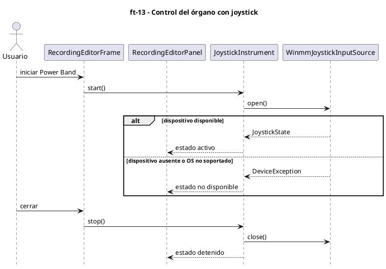

# Control del órgano con joystick

## General description

- Mostrar el estado del joystick USB sin bloquear la interfaz Swing.
- Conectar la entrada física al órgano activo mediante el patrón Bridge.
- Informar disponibilidad, desconexión y fallos sin impedir el arranque de otros instrumentos.

## Inputs

- Estados asincrónicos de botones y ejes del joystick.
- Evento de inicio, cierre o cambio de disponibilidad del instrumento.

## Outputs

- Indicador visual `activo`, `detenido` o `no disponible: ...`.
- Acciones de inicio y cierre coordinadas con el ciclo de vida de la ventana.
- Sin cambios directos al OSC desde la interfaz.

## Test criteria

- La UI reporta estado disponible sin requerir un dispositivo físico en pruebas.
- En Linux o arquitectura no soportada se muestra no disponible y el editor sigue abierto.
- Una desconexión muestra el error y libera el estado visual del órgano.
- Los cambios de botón/eje no ejecutan operaciones Swing bloqueantes.
- El cierre de la ventana solicita detener el joystick y deja el estado activo liberado.

## Assets

## Implementation guidelines

- Usar Java 25+, Maven y Java Swing.
- Mantener UI en `src/main/java/powerband/ui/`.
- Mantener lectura hardware en `src/main/java/powerband/instrument/` y mensajes OSC fuera de Swing.
- Agregar estados y textos a `src/main/java/powerband/util/IConstants.java`.
- El hardware se inicializa después de mostrar la ventana y no bloquea el EDT.

## Business workflow

1. Construir el instrumento joystick y mostrar el estado inicial.
2. Intentar abrir la fuente WinMM sin impedir otros instrumentos.
3. Publicar disponibilidad o error al panel.
4. Mantener el órgano activo mientras llegan eventos válidos.
5. Liberar el joystick y actualizar el estado al cerrar la ventana.
