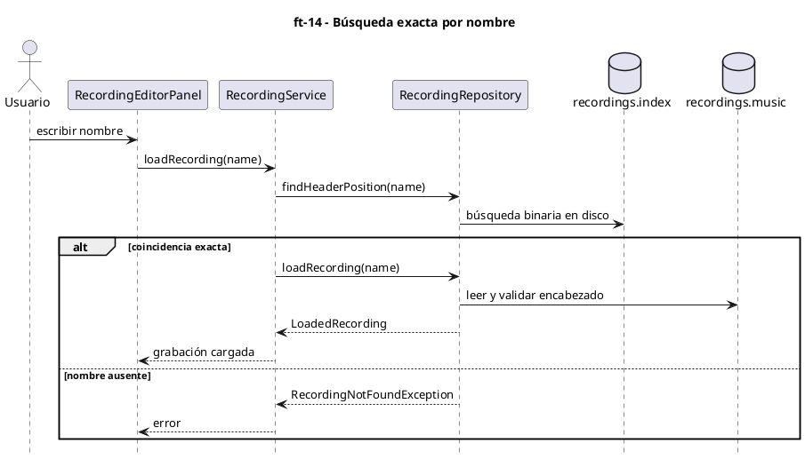

# Búsqueda binaria de grabaciones

## General description

- Permitir escribir o seleccionar el nombre exacto de una grabación desde Swing.
- Delegar la búsqueda al servicio y mostrar únicamente grabaciones encontradas.
- Conservar el estado cargado si el nombre no existe o el archivo es inválido.

## Inputs

- Nombre escrito o seleccionado por el usuario.
- Resultado `LoadedRecording`, `RecordingInfo` y excepciones del servicio.

## Outputs

- Grabación cargada y comandos disponibles para el editor/reproductor.
- Mensajes de nombre no encontrado, archivo corrupto o falla de E/S.
- Ningún cambio parcial en la pantalla si la búsqueda falla.

## Test criteria

- Una búsqueda por nombre exacto muestra la grabación cargada.
- Un nombre ausente muestra `RecordingNotFoundException` sin limpiar una grabación válida cargada previamente.
- El encabezado o los comandos inválidos muestran error y no habilitan reproducción.
- La búsqueda no usa recorridos de arreglos ni cambia el orden cronológico de `recordings.list`.
- Los controles de búsqueda permanecen fuera del EDT mientras el repositorio lee desde disco.

## Assets

## Implementation guidelines

- Java 25+, Maven y Swing.
- Mantener controles en `src/main/java/powerband/ui/`.
- Delegar búsqueda, validación y lectura a `src/main/java/powerband/service/` y `src/main/java/powerband/repository/`.
- Usar excepciones propias y textos constantes de `IConstants`.
- Ejecutar lecturas potencialmente lentas fuera del EDT y volver al EDT solo para actualizar UI.

## Business workflow

1. El usuario introduce o selecciona un nombre exacto.
2. La UI delega al servicio.
3. El servicio localiza el encabezado mediante el índice binario.
4. La UI carga metadatos y comandos solo si la validación terminó.
5. Ante error conserva la última grabación válida y presenta el mensaje.
