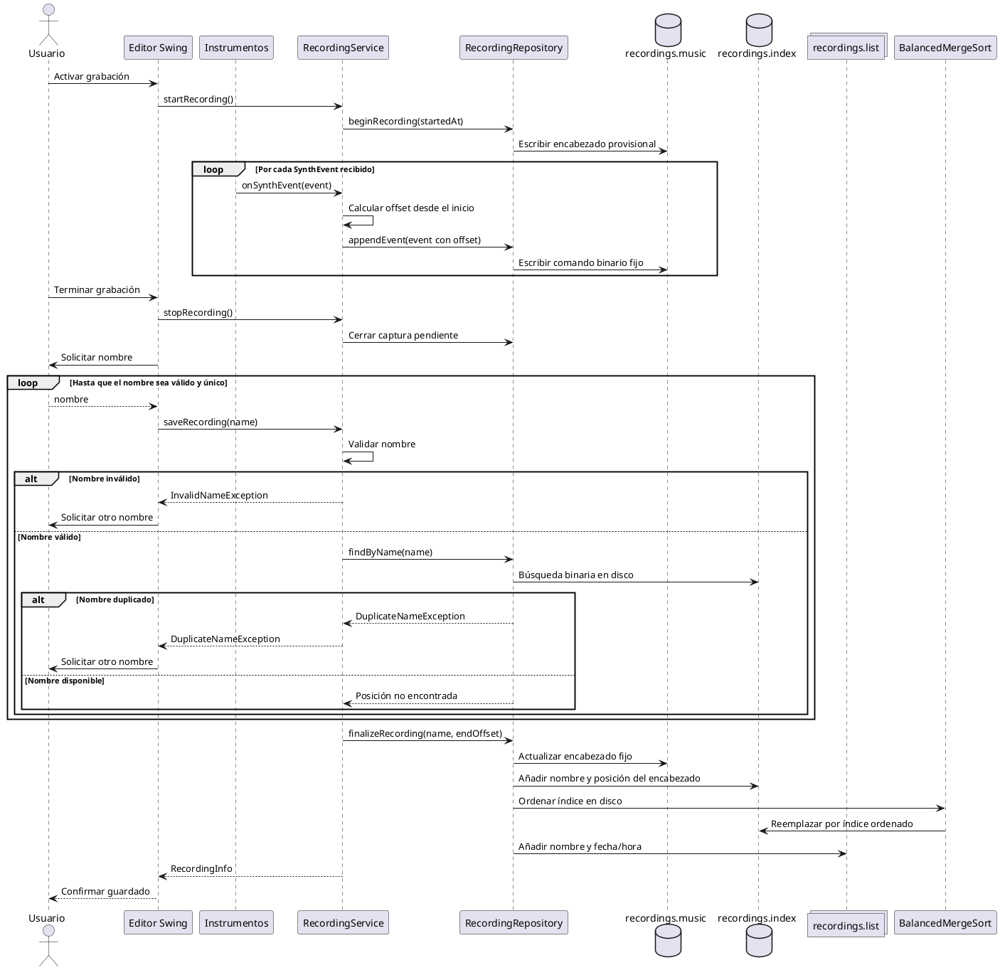

# Guardado de grabaciones del editor musical

## General description

- La interfaz Swing inicia y termina la captura de eventos de todos los instrumentos.
- Al terminar, solicita un nombre y vuelve a solicitarlo si está vacío, inválido o duplicado.
- Muestra el estado de grabación, la confirmación de guardado y los errores de persistencia.

## Inputs

- Acciones del usuario: iniciar y terminar grabación.
- Eventos `SynthEvent` notificados por los instrumentos al editor.
- `RecordingInfo` y excepciones entregados por el servicio.

## Outputs

- Llamadas a `RecordingService` para iniciar, detener y guardar una grabación.
- Indicador visual de captura activa y mensajes de error o confirmación.

## Test criteria

- Iniciar cambia la UI a estado de grabación y solicita iniciar el servicio una vez.
- Terminar detiene la captura antes de solicitar el nombre.
- Un nombre inválido o repetido conserva la grabación pendiente y permite intentar otro nombre.
- Un guardado exitoso muestra el nombre y vuelve al estado inactivo.
- Los errores de E/S se muestran al usuario; no se presentan como guardado exitoso.

## Assets

## Implementation guidelines

- Java 25+, Maven y Swing; usar las constantes de `src/main/java/powerband/util/IConstants.java`.
- Integrar la ventana/editor en `src/main/java/powerband/ui/`; delegar captura y persistencia a `src/main/java/powerband/service/`.
- Mantener los eventos de los instrumentos (`src/main/java/powerband/instrument/`) conectados al editor mientras la grabación está activa.
- Aplicar las convenciones del proyecto: parámetros con prefijo `p`, campos encapsulados y excepciones explícitas.

## Business workflow

1. El usuario activa la grabación; la UI actualiza su estado y llama al servicio.
2. Mientras se graba, el editor acepta eventos de todos los instrumentos.
3. Al terminar, la UI detiene la captura y solicita el nombre.
4. Si el servicio rechaza el nombre por inválido o repetido, la UI solicita otro sin descartar la captura pendiente.
5. Al confirmar el guardado, la UI presenta el resultado y vuelve al estado inactivo.
